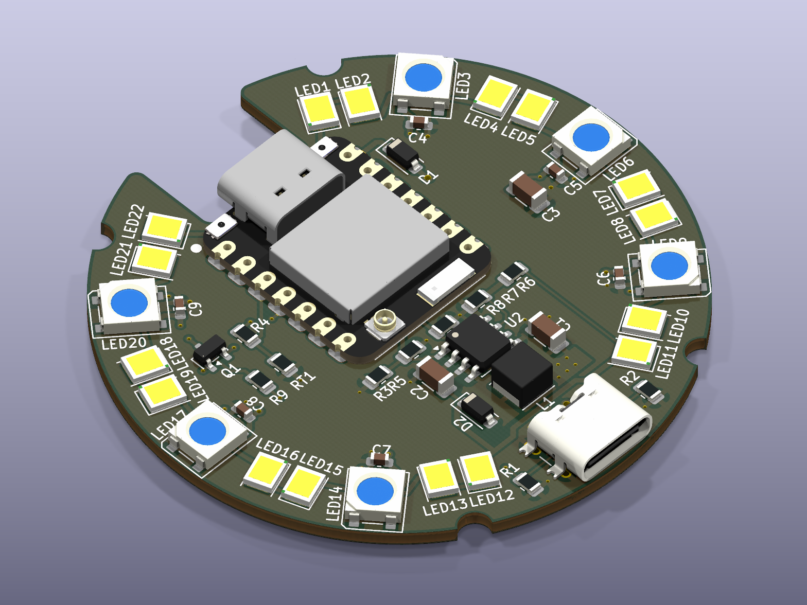

# terrarium-smart-light

An ESP32-based smart grow light for terrariums: a compact 56 mm round board with components on one side with full-spectrum white LEDs for plant growth, addressable RGB LEDs for effects, and Wi-Fi control.

## Features (planned)
- Seeed Studio XIAO module soldered directly to the board (ESP32-C6 recommended for its on-board antenna; the S3 and C3 also fit)
- Dimmable, wide-angle (120°) warm white LEDs (ams OSRAM DURIS E 2835, 3000 K, CRI 90+) on a constant-current boost driver (Legend-Si LGS63032EP, flicker-free PWM dimming)
- Addressable RGB pixels (WS2812-compatible) for sunrise/sunset, moonlight and effects
- A separate USB-C power port (5 V, works with any 2–3 A USB-C charger). The firmware reads the charger's advertised current and limits brightness to match
- 4-layer PCB with every component on one side (the back sits flat on a heatsink). JLCPCB Economic assembly places all LCSC parts; only the XIAO is hand-soldered
- Day/night schedule with sunrise and sunset ramps, a web UI, OTA updates, and Home Assistant via MQTT

## Repository layout
| Folder | Contents |
|---|---|
| [docs/](docs/) | Design plan ([docs/plan.md](docs/plan.md)) and research notes ([docs/research/](docs/research/)) |
| [hardware/](hardware/) | KiCad project, BOM, fabrication outputs |
| [firmware/](firmware/) | PlatformIO project for the XIAO (ESP32-C6 primary, S3 supported) |
| [enclosure/](enclosure/) | Enclosure STEP files exported from Onshape |

## Mechanical design
The enclosure is designed in Onshape: [Terrarium Smart Light enclosure (Onshape)](https://cad.onshape.com/documents/52f2a238255e278aeea46164/w/27e2eabc0946d9f68195188c/e/e4bc6922c2e565c6999771c4). The Onshape document is the source of truth; the STEP files in [enclosure/](enclosure/) are exports of it, so re-export them after changing the design.

| File | Part |
|---|---|
| [enclosure/main_enclosure.step](enclosure/main_enclosure.step) | Main enclosure body |
| [enclosure/frosted_window.step](enclosure/frosted_window.step) | Frosted window over the LEDs |

The PCB model used in the assembly is [hardware/Terrarium Smart Light.step](hardware/Terrarium%20Smart%20Light.step), exported from KiCad with `kicad-cli pcb export step --subst-models --no-optimize-step`. It mounts with the four M3 holes on the board edge.

## Status
PCB v0.6 has been sent for manufacture (JLCPCB); bring-up and firmware testing follow once boards arrive. The enclosure is designed in Onshape. See [docs/plan.md](docs/plan.md) for the architecture, power budget, BOM and open decisions.
